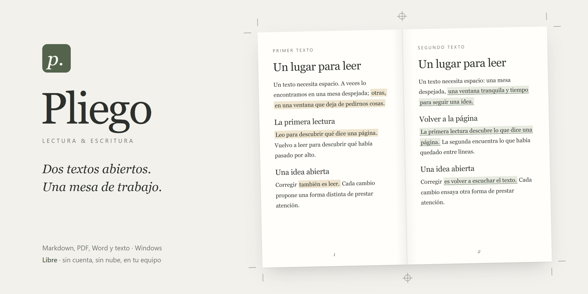
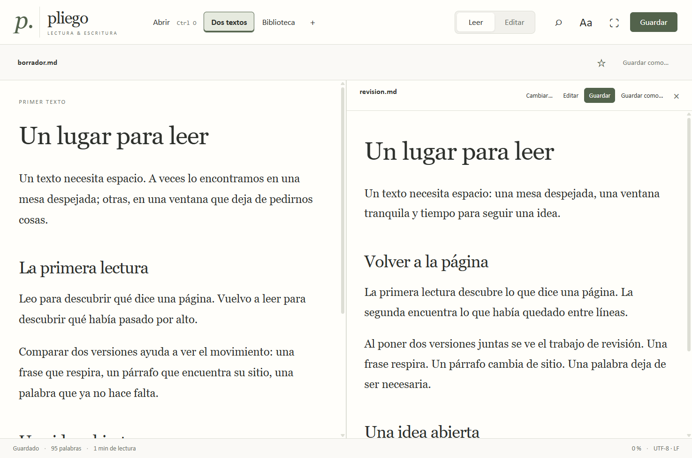

Pliego es una aplicación libre para Windows que permite leer dos documentos en una misma ventana, cada uno con su desplazamiento, búsqueda y controles. Nació de una necesidad sencilla: trabajar con un borrador y su revisión sin estar colocando ventanas una y otra vez.

Funciona en tu equipo, sin cuenta ni servicios externos. Los documentos siguen siendo archivos normales en sus carpetas.



## Descargar y abrir

1. Descarga el ZIP para **Windows x64** de la [última versión](https://github.com/pablomartinezmake-code/pliego/releases/latest).
2. Descomprime la carpeta completa en una ubicación donde puedas escribir.
3. Abre **Pliego.exe**. No necesitas Node.js para usarlo.

Conserva todos los archivos de la carpeta.

**Windows puede avisar al abrirlo.** El ejecutable todavía no tiene firma digital, así que Windows no sabe quién lo ha publicado y puede mostrar una ventana azul de SmartScreen diciendo que ha protegido el equipo. Para abrirlo, pulsa **Más información** y después **Ejecutar de todas formas**.

El ZIP también incluye un instalador opcional **Install-Pliego.ps1**, que coloca Pliego en una ruta estable de tu usuario y crea accesos en Escritorio e Inicio. Cierra Pliego antes de instalar o actualizar. La instalación conserva los documentos y los datos de lectura locales.

Desde una terminal abierta en la carpeta descomprimida, puedes ejecutarlo con `powershell.exe -NoProfile -File .\Install-Pliego.ps1`. Si la configuración de tu equipo no permite scripts, puedes usar Pliego directamente desde su carpeta portable.

Para abrir archivos `.md` al hacer doble clic, selecciona **Abrir con → Elegir otra aplicación**, busca el ejecutable de la instalación y elige **Siempre**. Pliego no cambia por su cuenta la aplicación predeterminada.

## Leer dos textos

Abre el primer archivo y pulsa **Dos textos**, junto a **Abrir**, para elegir el segundo. También puedes usar **＋ → Abrir al lado…** o **Ctrl+Alt+O**. En PDF, el botón se llama **Dos PDF**.

Cada panel tiene su propio desplazamiento y búsqueda. Los Markdown se pueden editar y guardar por separado. **Ctrl+S** guarda el panel en el que estás trabajando. Al cambiar un archivo o cerrar la ventana, Pliego pregunta por los cambios pendientes.

El modo **Ambas** muestra el Markdown y la vista previa del mismo archivo. Para ver dos archivos distintos se usa **Dos textos**.

## Qué puedes hacer

- **Markdown:** leer, editar, buscar y guardar, con tablas, notas al pie y vista previa. Conserva UTF-8, BOM y los saltos de línea originales.
- **PDF:** leer, seleccionar y buscar texto, consultar el índice, abrir otro PDF al lado y guardar notas, marcadores y resaltados en un cuaderno local.
- **Word y texto plano:** abrir `.docx` y `.txt` en lectura. La vista de Word conserva contenido y estructura; la paginación puede cambiar.
- **Biblioteca:** explorar carpetas, filtrar archivos por nombre o formato, guardar favoritos y volver a los recientes.
- **Lectura:** ajustar tamaño, ancho y tipografía; elegir papel, marfil o noche.

## Archivos y datos locales

El guardado de Markdown es manual. Antes de reemplazar un archivo, Pliego conserva una copia anterior en `%APPDATA%/Pliego/backups/`. Si el archivo cambió desde otro programa, rechaza el guardado y mantiene la edición en pantalla. **Guardar como** permite conservarla en otro archivo.

Las notas de PDF se guardan aparte del original en `%APPDATA%/Pliego/notebooks/`, vinculadas a su ruta y contenido. Los resaltados no se incrustan en el PDF. **Exportar fichas** guarda los pasajes y comentarios como Markdown. Exporta tus fichas antes de mover o reemplazar un PDF.

No hay telemetría, IA, cuenta, servidor ni sincronización. Los enlaces web piden confirmación antes de abrirse en el navegador. Las imágenes remotas no se descargan.

## Límites de esta primera versión pública

Pliego está disponible para **Windows x64**. PDF, Word y TXT se abren para lectura; solo Markdown se edita. No incluye OCR, PDF con contraseña, edición visual de Word, comparación automática de diferencias ni fusión de versiones.

Los PDF admiten hasta 200 MiB y búsqueda de texto en las primeras 3.000 hojas. La biblioteca limita el inventario a 5.000 documentos o 20.000 entradas e informa si queda parcial.

La hoja del PDF y el folio impreso son localizadores distintos. El folio se introduce después de leerlo en la imagen de esa misma página; Pliego no lo calcula.

## Atajos

| Acción | Atajo |
| --- | --- |
| Abrir documento | Ctrl+O |
| Abrir otro documento al lado | Ctrl+Alt+O |
| Nuevo Markdown | Ctrl+N |
| Guardar el panel activo | Ctrl+S |
| Guardar como | Ctrl+Mayús+S |
| Buscar en el panel activo | Ctrl+F |
| Leer / Markdown y vista previa / Editar | Ctrl+1 / Ctrl+2 / Ctrl+3 |
| Lectura sin distracciones | Ctrl+Mayús+F; Escape para volver |
| Mostrar el menú de Windows | Alt |

## Desarrollo

Requiere Node.js 22.12 o posterior y npm. Las dependencias quedan fijadas en `package-lock.json`.

```powershell
npm ci
npm run build
npm test
npm run test:ui
npm run test:two-texts
npm run test:library
npm run package
npm run test:packaged
```

`npm start` compila y abre la aplicación. Las pruebas usan documentos sintéticos y perfiles aislados bajo `test-results/`. No necesitan una biblioteca personal. El empaquetado produce el ejecutable portable y el ZIP de distribución bajo `release/`.

Los ejemplos de `examples/` y las muestras de `tests/fixtures/` son sintéticos. Para regenerar estas últimas se necesita Python con `reportlab`, `python-docx` y `Pillow` (`python scripts/make-fixtures.py`). No hace falta Python para compilar ni utilizar Pliego.

## Errores y contribuciones

Puedes [abrir una incidencia](https://github.com/pablomartinezmake-code/pliego/issues) con tu versión de Windows y Pliego, los pasos para reproducir el problema y el resultado esperado. Si adjuntas un archivo o captura, utiliza un ejemplo sin datos personales.

Para proponer un cambio, explica qué necesidad resuelve y cómo lo has comprobado. Son bienvenidas las mejoras que mantienen la lectura sencilla y el control sobre los archivos locales.

## Licencia y créditos

Pliego se distribuye bajo la [licencia MIT](LICENSE). Puedes usarlo, modificarlo y compartirlo respetando sus condiciones.

Creado por **Pablo Martinez Samper**, con asistencia de herramientas de IA en el desarrollo y las pruebas. Utiliza Electron, CodeMirror, PDF.js, Mammoth, marked, DOMPurify y otras bibliotecas libres. Sus avisos y licencias se recogen en [THIRD_PARTY_NOTICES.md](THIRD_PARTY_NOTICES.md).
